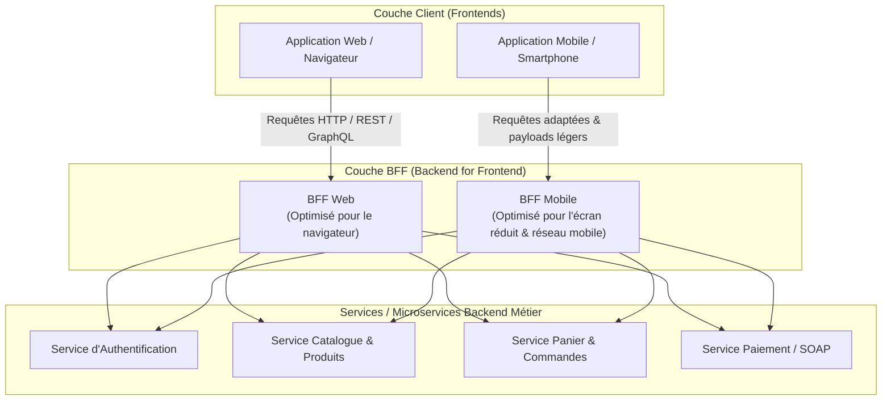
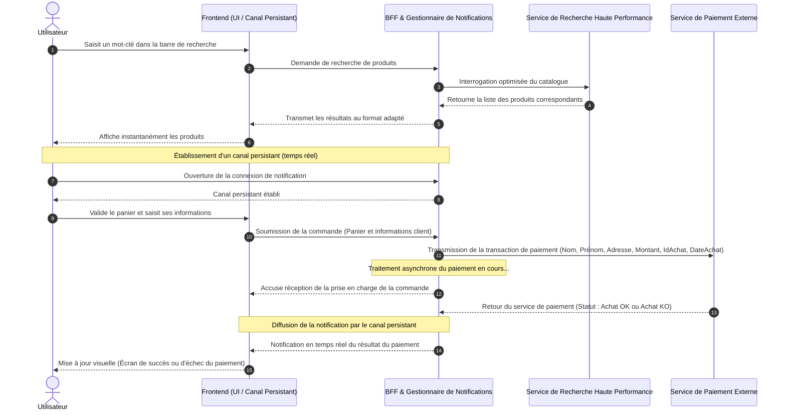
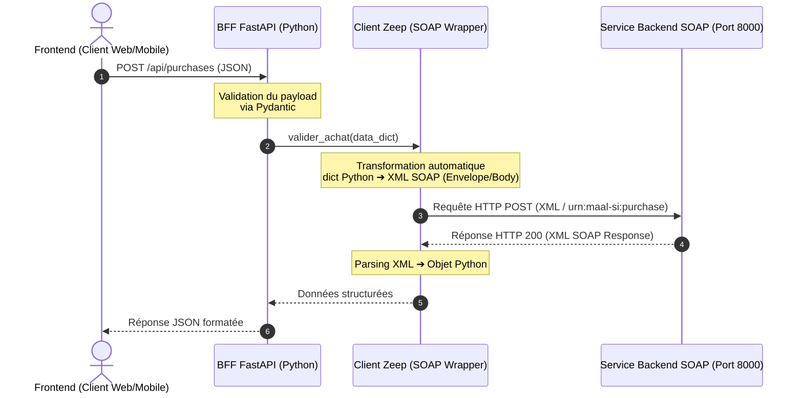

## SOAP
### exemple WSDL
1 . http://www.dneonline.com/calculator.asmx?WSDL

#### Exercice 1
Implémenter ce service en C# ou Python ou node

#### Exercice 2
Implémenter un service de paiement.

* **Nom :** Nom de famille du client.
* **Prénom :** Prénom du client.
* **Adresse :** Adresse complète de facturation ou de livraison.
* **Montant :** Montant financier global de la transaction.
* **IdAchat :** Identifiant unique universel rattaché au panier ou à la commande.
* **DateAchat :** Horodatage précis (date et heure universelles) de la validation de la transaction.

Retour
* **Retour :** Achat OK/KO

# TD Global


# Spécifications Techniques et Fonctionnelles : Site E-Commerce Moderne

## 1. Vue d'ensemble et Objectifs

Le projet consiste à concevoir un site e-commerce performant intégrant :

* Une **recherche de produits ultra-rapide** optimisée par un protocole de communication distant direct et léger.
* Un **panier d'achat** et un parcours de commande fluide.
* Un **service de paiement sécurisé** s'appuyant sur un protocole web de type services web basés sur des enveloppes structurées.
* Des **notifications en temps réel** par flux bidirectionnels permanents pour informer instantanément l'utilisateur de l'état de son paiement et de sa commande.

---

## 2. Architecture Technique (Frontend -> BFF -> Services)


L'architecture repose sur un découplage rigoureux en couches pour séparer l'interface utilisateur, l'orchestration et les services métiers :

* **Frontend (Interface Utilisateur) :** Application cliente responsable de l'affichage du catalogue, de la saisie des formulaires, de la gestion locale du panier et du maintien d'une connexion persistante pour les notifications en direct.
* **BFF (Backend for Frontend) :** Passerelle applicative centrale. Elle centralise les requêtes de l'interface, gère la sécurité, traduit les requêtes de recherche vers le microservice dédié, pilote les notifications en temps réel et formate les requêtes vers le service de paiement externe.
* **Microservice de Recherche :** Service interne hautes performances dédié exclusivement à l'indexation et à l'interrogation rapide du catalogue de produits.
* **Service de Paiement (SOAP) :** Service distant ou simulé validant la transaction financière à partir des données personnelles et d'achat transmises de manière sécurisée.

A la fin du TD on mettra en place un système comme Kafka pour la gestion event/message.

---

## 3. Diagramme de Séquence et d'Architecture



---

## 4. Modèle de Données du Paiement

La transaction financière transmise au service de paiement externe respecte un contrat précis divisé en deux parties :

### Données d'entrée (Requête de paiement)

* **Nom :** Nom de famille du client.
* **Prénom :** Prénom du client.
* **Adresse :** Adresse complète de facturation ou de livraison.
* **Montant :** Montant financier global de la transaction.
* **IdAchat :** Identifiant unique universel rattaché au panier ou à la commande.
* **DateAchat :** Horodatage précis (date et heure universelles) de la validation de la transaction.

### Données de sortie (Réponse du paiement)

* **Statut de retour :** Libellé textuel indiquant obligatoirement soit l'état de validation (`Achat OK`), soit l'état d'échec (`Achat KO`).

---

## 5. Parcours Utilisateur et Flux Fonctionnel

1. **Recherche de produits :** L'utilisateur tape sa recherche. La requête transite par le BFF qui l'exécute via le protocole de recherche haute performance pour un affichage instantané.
2. **Constitution du panier :** L'utilisateur sélectionne ses articles et initialise son parcours d'achat.
3. **Canal de notification :** En arrière-plan, l'interface établit un canal de communication bidirectionnel persistant avec le BFF pour écouter les futurs événements de la commande.
4. **Saisie des informations :** Le client renseigne ses informations personnelles (Nom, Prénom, Adresse).
5. **Validation et Paiement :**
* L'utilisateur valide sa commande.
* Le BFF rassemble les données du panier, génère l'identifiant unique, horodate la transaction et transmet l'ensemble au service de paiement externe.


6. **Notification du résultat :** Dès que le service de paiement renvoie sa réponse (`Achat OK` ou `Achat KO`), le BFF pousse immédiatement l'information au client via le canal en temps réel, permettant à l'interface d'afficher la confirmation ou l'erreur sans rechargement de page.

## La partie paiement


### Comment s'effectue la transformation (JSON ➔ SOAP) ?

1. **Validation du JSON (Entrée Frontend) :**
Le frontend (React, Vue, mobile) envoie une requête `POST /api/purchases` contenant un JSON propre et typé. FastAPI intercepte ce JSON et le valide automatiquement grâce à un modèle **Pydantic** (qui s'assure par exemple que le montant est bien un nombre, que la date est valide, etc.).
2. **Mapping et Appel SOAP (Zeep) :**
Le BFF récupère les données validées sous forme de dictionnaire Python, puis appelle la méthode SOAP correspondante (ex: `ValiderAchat`) exposée par le client Zeep. **Zeep se charge en interne de convertir automatiquement ce dictionnaire Python en enveloppe XML/SOAP** (avec les bons namespaces `urn:maal-si:purchase` et les bonnes balises comme `<tns:Nom>`).
3. **Réponse vers le Frontend :**
Le service SOAP renvoie du XML brut. Zeep le convertit en objet Python, et votre BFF le transforme à nouveau en un objet JSON élégant pour le renvoyer au frontend.

---

### Diagramme de Séquence (Mermaid)




### Lancer le serveur SOAP et le BFF

Depuis le dossier du projet, ouvrir deux terminaux PowerShell :

1. **Démarrer le serveur SOAP** (port `8000`) :

```powershell
python -m uvicorn server_soap:app --host 0.0.0.0 --port 8000
```

Puis vérifier que le service répond à l'adresse :

```text
http://localhost:8000/purchase?wsdl
```

2. **Démarrer le BFF FastAPI** (port `8081`, par exemple) :

```powershell
python -m uvicorn main:app --reload --port 8081
```

Le BFF est alors accessible à l'adresse :

```text
http://localhost:8081
```

Sa documentation interactive Swagger est disponible ici :

```text
http://localhost:8081/docs
```

Pour fonctionner ensemble, le BFF doit être configuré avec l'adresse du serveur SOAP, par exemple :

```python
SOAP_URL = "http://localhost:8000/purchase?wsdl"
```

### Installer les dépendances

Depuis le dossier du projet, ouvrez PowerShell et installez les dépendances listées dans `requirements.txt` :

```powershell
python -m pip install -r requirements.txt
```

## Protocol Buffers (Proto) avec gRPC

Protocol Buffers (Proto) est un format de définition de données compact, indépendant du langage. Un fichier `.proto` décrit les messages échangés (champs et types) et peut également définir des services gRPC. Chaque champ a un numéro unique qui fait partie du format binaire : conservez ces numéros lors des évolutions du contrat.

Exemple de `protos/product.proto` :

```proto
syntax = "proto3";

package product;

message Product {
    int32 id = 1;
    string name = 2;
    double price = 3;
}
```

### Générer le code Python

Depuis la racine du projet, installez les outils si nécessaire :

```powershell
python -m pip install grpcio grpcio-tools
```

Exécutez ensuite la commande de compilation :

```powershell
python -m grpc_tools.protoc -Iprotos --python_out=. --grpc_python_out=. protos/product.proto
```

`-Iprotos` indique le dossier où chercher les fichiers `.proto`, et `protos/product.proto` est le fichier compilé. `--python_out=.` génère le code des messages, généralement `product_pb2.py`. `--grpc_python_out=.` génère les stubs client et serveur, généralement `product_pb2_grpc.py`, lorsque le fichier définit un service gRPC. Les deux fichiers sont créés à la racine (`.`). Si le fichier ne contient que des messages, `product_pb2.py` suffit.

Importez le module généré pour créer et sérialiser des messages, par exemple : `product_pb2.Product(id=1, name="Clavier", price=49.99)`. Pour appeler un service gRPC, utilisez le stub généré dans `product_pb2_grpc.py` avec un canal gRPC. Après chaque modification du `.proto`, relancez la commande pour régénérer les modules.

Si le projet utilise un environnement virtuel, activez-le avant l'installation :

```powershell
python -m venv .venv
.\.venv\Scripts\Activate.ps1
python -m pip install -r requirements.txt
```


